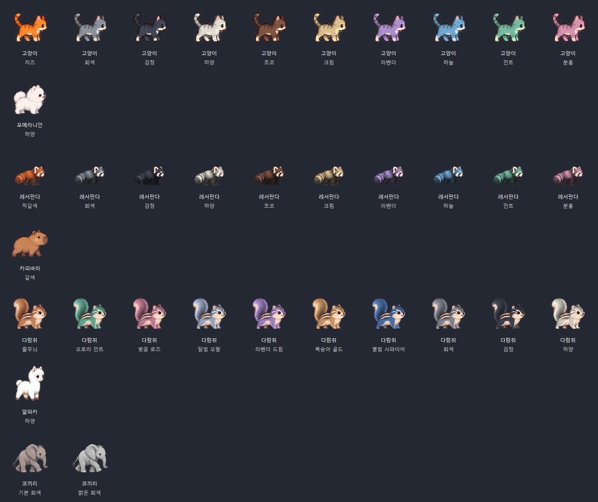
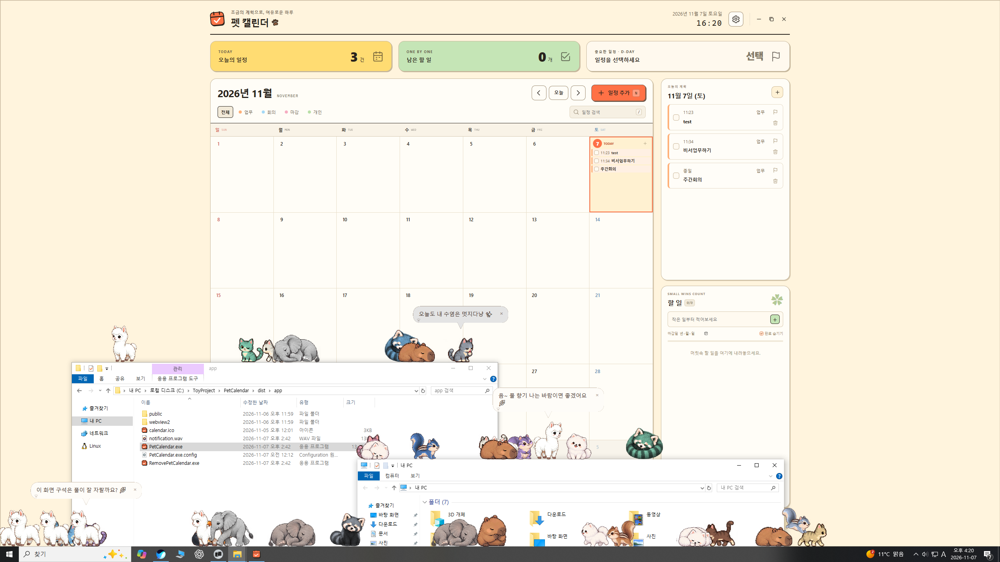

# 펫 캘린더 · PetCalendar

일정과 할 일을 정리하고, 데스크톱 펫과 함께하는 Windows 캘린더입니다.

캘린더 창은 웹 엔진 없이 Windows 기본 화면 기능(WinForms)으로 직접 그립니다. 가볍고 빠르게 열리며, 메모리는 40~60MB 정도만 사용합니다(이전 WebView2 버전은 260MB 이상). v2.x에서 업데이트해도 일정·할 일·설정·펫이 그대로 이어집니다.

[최신 설치 파일 다운로드](https://github.com/luke1546/PetCalendar/releases/latest) · **v3.4.2**

설치 없이 쓰고 싶다면 릴리스의 `PetCalendar-Portable.exe` 하나만 받아 실행하세요. 처음 실행할 때 앱 파일을 `%LOCALAPPDATA%\PetCalendar\portable`에 풀어서 실행하며, 일정은 설치판과 같은 위치에 저장됩니다.

이 문서는 `main` 브랜치 기준입니다. 설치 파일의 기능은 해당 [릴리스 안내](https://github.com/luke1546/PetCalendar/releases)와 함께 확인하세요.

## 화면


| 바탕화면 위젯 | 펫 말풍선 |
| --- | --- |
|  |  |

### 데스크톱 펫 7종

고양이, 포메라니안, 레서판다, 카피바라, 다람쥐, 알파카, 코끼리가 바탕화면을 돌아다닙니다. 고양이·레서판다·다람쥐는 여러 색상으로 만날 수 있어요.



이미지는 실제 펫 렌더러로 그린 색상별 정지 화면입니다. 앱에서는 걷기·점프와 같은 동작을 볼 수 있습니다.



### 밤에는 방석에서 꿀잠


밤(23시~6시)이나 10분 넘게 자리를 비우면 펫들이 작업 표시줄 위 방석으로 모여 잠들어요. 방석은 끌어서 옮기고, 우클릭으로 치울 수 있습니다.

## 주요 기능

- 일정과 할 일, 반복 일정, 완료 표시, 검색 및 D-day
- 바탕화면 위젯과 일정 알림, JSON 백업
- 드래그로 옮기기: 달력·오늘의 계획의 일정을 다른 날짜로, 일정을 할 일 칸으로, 할 일을 달력 날짜로 (반복 일정은 적용 범위 선택)
- 일정이 많은 날의 **+N개 더 보기**를 누르면 그날 일정 전체를 팝업으로 확인
- 실행 취소·다시 실행: 삭제·이동·완료 등 모든 변경을 **Ctrl + Z / Ctrl + Y**로 되돌리기
- **다가오는 7일** 목록: ‘오늘의 일정’ 카드나 **W** 키로 일주일 일정을 날짜별로 확인
- 새 일정 창의 **자주 쓰는 일정** 칩: 제목·분류·시간을 한 번에 채우기
- **나만의 분류**: 새 일정 창의 **+ 분류**로 ‘운동’, ‘공부’ 같은 분류를 색과 함께 바로 추가하고, 분류를 우클릭해 지울 수 있어요 (최대 20개)
- 펫이 챙겨줘요: 아침 첫 안내(오늘 일정·마감 개수), 마감 전날 알림, 일요일 저녁 주간 정리와 연속 달성 일수
- 펫끼리 마주치면 서로 이름을 부르며 인사하고, 마우스를 가까이 가져가면 가장 가까운 한 마리만 털실 공을 쫓아와요. 펫 윤곽에서 50px 안에서 시작하고, 110px 밖으로 멀어지면 바로 사라져요 (화면 배율 반영)
- **호감도 · 간식**: 할 일·일정을 끝내면 간식이 1개씩 생기고, 펫을 우클릭해 줄 수 있어요(펫마다 10분에 한 번). 끝내기·쓰다듬기·놀이로 호감도가 오르며 낯가림 → 친해지는 중 → 친구 → 단짝 → 가족 5단계마다 말투와 대사가 바뀌어요. 이름표에는 친구까지 🌟, 단짝은 💚, 가족은 💖가 컬러 이모지로 표시돼요. ‘가족’이 되면 설정에서 정한 호칭으로 불러요
- **펫 일기**: 정한 시간(기본 오후 5시 50분, 설정에서 변경)이 지나면 펫이 그날 집사가 끝낸 일정과 자기 하루를 일기로 남겨요 (**D** 키로 보기)
- 2020~2050년 대한민국 공휴일 표시와 공휴일 펫 인사
- 글씨 크기(작게 · 보통 · 크게)와 글꼴 선택: 기본, 주아, 초록우산어린이
- 초록우산어린이는 한글 11,172자를 지원하는 경량 확장 시험판으로, ‘뷁·똠·힣’처럼 기존에 비어 있던 글자도 표시합니다
- 펫별 이름과 성격, 컬러 이모지가 포함된 일상 대화와 일정 안내. 이름을 지으면 펫 머리 위에 이름표가 따라다닙니다
- 펫 더블클릭으로 오늘 일정 확인
- 오늘 일정 완료 시 축하 반응, 전부 완료하면 특별한 축하 멘트
- 아침 인사와 늦은 밤 졸린 반응
- 위젯과 펫 표시 여부, 알림 소리와 안내 주기 설정
- 처음 실행할 때 일정 추가·단축키·펫 추가를 알려주는 3단계 퀵투어

## 처음 시작하기

1. 날짜를 선택하고 **+ 일정 추가**를 눌러 일정을 저장하세요.
2. **Alt + \`**(숫자 1 왼쪽 키)로 캘린더를 숨기거나 다시 여세요. 기본 단축키이며, 다른 프로그램을 사용 중에도 작동합니다. 설정에서 변경할 수 있습니다.
3. **설정 및 백업 → 데스크톱 펫**에서 종류를 고르고 **한 마리 추가**를 누르세요.

새 사용자 설정으로 처음 실행하면 데스크톱 펫이 켜지고 고양이 한 마리가 나타납니다. 퀵투어는 완료하거나 건너뛰면 다시 표시되지 않습니다.

### 단축키

| 키 | 동작 |
| --- | --- |
| Alt + \` | 캘린더 창 숨기기·열기 (어디서나, 설정에서 변경 가능) |
| N | 선택한 날짜에 일정 추가 |
| T | 오늘로 이동 |
| W | 다가오는 7일 보기 |
| D | 펫 일기 보기 |
| ← / → | 이전·다음 달 |
| / | 일정 검색 |
| Ctrl + Z / Ctrl + Y | 실행 취소 / 다시 실행 |
| Esc | 열린 창 닫기 |

### 펫과 함께하기

펫을 클릭하면 쓰다듬고, 드래그하면 옮길 수 있습니다. 더블클릭하면 해당 펫이 오늘 일정을 말풍선으로 알려줍니다. 우클릭 메뉴에서는 이름과 성격, 크기를 바꾸거나 펫을 추가할 수 있습니다.

데스크톱 펫을 켜둔 상태에서 오늘 일정을 완료하면 펫이 축하하고, 오늘의 모든 일정을 끝내면 특별한 멘트를 들려줍니다. 미확인 시간 알림이 있으면 먼저 표시하고, 축하는 그 뒤에 이어집니다.

일상 대화를 켜면 오전 6~10시에 아침 인사를 하고, 밤 11시~새벽 5시에는 졸린 인사와 잠깐 조는 동작을 합니다. 반응은 펫의 대화 주기에 맞춰 나타납니다.

설정창은 **데스크톱 펫 → 단축키·바탕화면 위젯 → 일정 알림 → 데이터·백업 → 화면** 순서이며, 열 때는 데스크톱 펫 항목만 펼쳐집니다. **펫 모두 보내기**는 이름 없는 펫만 보내며, 이름을 지은 펫과 데스크톱 펫 사용 설정은 유지합니다.

### 공휴일 자료

대한민국 공휴일은 앱에 포함된 자료로 오프라인에서 표시합니다. 현재는 2020~2050년을 지원하며, 2028~2050년은 현재 규칙에 따른 예상 공휴일입니다. 그 밖의 연도에는 ‘공휴일 자료 없음’이 표시됩니다. 임시공휴일과 향후 변경사항을 포함한 연도별 자료 갱신 방법은 [공휴일 자료 관리](docs/HOLIDAYS.md)를 참고하세요.

## 실행 환경

Windows x64, .NET Framework 4.8이 필요합니다. Microsoft Edge WebView2 Runtime은 더 이상 필요하지 않습니다. 일정과 설정은 사용자 PC의 `%LOCALAPPDATA%\PetCalendar\data`에 저장됩니다.

## 소스에서 빌드

저장소 폴더에서 Windows PowerShell로 다음 명령을 실행합니다.

```powershell
.\desktop\build.ps1
```

결과물은 `dist/app/PetCalendar.exe`입니다. 설치 파일 생성에는 NSIS가 필요하며, 설치한 컴파일러 경로를 지정할 수 있습니다.

```powershell
.\desktop\package.ps1 -Compiler 'C:\Program Files (x86)\NSIS\makensis.exe'
```

테스트는 앱을 빌드한 뒤 Windows에서 실행합니다. `.mjs` 테스트에는 Node.js도 필요합니다.

```powershell
node --test tests/native-pets-tour.test.mjs
node --test tests/calendar.test.mjs tests/calendar-index.test.mjs tests/calendar-order-repeat.test.mjs tests/desktop-parity.test.mjs
powershell -ExecutionPolicy Bypass -File tests/brand-migration.ps1
powershell -ExecutionPolicy Bypass -File tests/pet-schedule.ps1
```

펫 설정, 퀵투어 펫 추가, 재시작 보존은 `tests/native-pets-tour.test.mjs`가 앱의 자동화 명령으로 검증합니다. 브랜드 이전 규칙은 `brand-migration.ps1`이 `Core.cs`를 직접 컴파일해 검증합니다.

## 구성

- `desktop/` — Windows 앱, 위젯, 펫과 호스트 소스
- `desktop/native/` — 캘린더 창 네이티브 구현 (화면 그리기, 입력 필드, 대화상자, 설정, 일정 로직)
- `desktop/ui/model.mjs` — 일정 계산 기준 원본(테스트가 C# 계산과 비교). `holidays.json`은 빌드에 포함되는 공휴일 자료입니다.
- `desktop/pet-engine/` — 펫 애니메이션 및 동작 엔진
- `desktop/pets.zip` — 앱에 포함되는 동물 이미지와 프레임 정보
- `desktop/emoji.zip` — 말풍선에서 사용하는 컬러 이모지 이미지
- `desktop/fonts.zip` — 설정에서 고를 수 있는 글꼴 (필요할 때만 불러옵니다)
- `tests/` — 일정, 위젯, 펫과 설치 동작 검증
- `tools/` — 공휴일 자료와 동물 이미지 팩을 만드는 스크립트
- `docs/screenshots/` — 샘플 데이터로 촬영한 화면

동물 에셋은 제작자의 `token-usage-main` 프로젝트에서 가져왔습니다. 컬러 이모지는 Twemoji를 사용하며, 출처와 라이선스는 [EMOJI-LICENSE.md](desktop/EMOJI-LICENSE.md)를 참고하세요. 함께 들어 있는 글꼴 중 주아는 SIL Open Font License 1.1을, Sandoll 초록우산어린이는 초록우산 어린이재단·산돌의 무료 재배포 조건을 따릅니다. 자세한 내용은 [FONT-LICENSE.md](desktop/FONT-LICENSE.md)에 정리했습니다.
