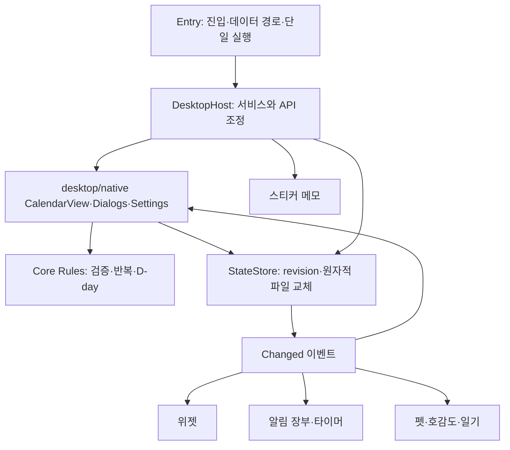

# 펫 캘린더 종합 진단 · 2026-11-15

## 판단

일정의 일반 저장·복원·재시작과 주요 편집 동작은 작동한다. 그러나 **저장·알림의 실패 복구와 통합 복원의 성공 판정부터 수정해야 한다.** C#/JavaScript 결과가 일치한다는 사실만으로 일정 계산의 정확성을 보장할 수 없다. 두 구현에서 동일한 D-day 오류가 재현됐다.

검토는 코드 수정과 배포를 포함하지 않는다. 제품 소스는 수정하지 않았으며, 재현 도구와 검토 문서를 추가했다. 모든 실행은 검토용 실행 파일과 별도 데이터 디렉터리를 사용했다. 실제 설치판의 교체, 릴리스 발행, QA 등록·제거는 수행하지 않았다.

## 대상과 근거

- 작업본 전체를 살피되, 실행 검증은 `desktop/build.ps1`에 포함되는 소스를 기준으로 한다.
- 성능 대상: `artifacts/review-2026-11-15-final/app/PetCalendar.exe`. 소스와 리소스는 같은 디렉터리의 `source/`에 보관했다.
- 해당 실행 파일 SHA-256: `bee767857ff1b8d34a540e68200e388a867c9856529cda0e96bc303b636dbd71`.
- 최신 작업본 자동 검증: [results.json](../artifacts/review-2026-11-15-latest/results.json), 개별 명령과 오류는 그 아래 `logs/`.
- 성능 전체 18개 표본과 시작 30회: [성능 결과](../artifacts/review-2026-11-15-final/results.json).
- 알림 재시도·실제 단축키 충돌을 포함한 핵심 11개 재현: 최신 결과의 `coreChecks`와 [실행 로그](../artifacts/review-2026-11-15-latest/logs/review-core.log).
- 실제 화면·Windows 키 메시지·편집·반복 범위·수명 검증: [UI 결과](../artifacts/review-2026-11-15-latest/ui/evidence/results.json).
- 패키징: [결과](../artifacts/review-2026-11-15-packaging/results.json), [실행 스크립트](../artifacts/review-2026-11-15-packaging.ps1).

검토 도중 다른 작업에서 제품 파일도 바뀌었다. 성능 결과를 최신 작업본 전체의 결과로 일반화하지 않는다. 마지막 최신 작업본 재검증과 변경 파일 목록은 아래에 별도로 기록한다. `results.json`의 `changedDuringReview`는 검토 도구·문서 변경까지 포함하므로 제품 변경과 구분한다.

산출물은 저장소의 `artifacts/` 제외 규칙에 따라 로컬에 보관된다. 다른 환경에서 보고서를 공유할 때는 해당 증거 폴더도 함께 전달하거나 재현 명령으로 다시 생성해야 한다.

## 실제 실행 구조



- 현재 화면은 `desktop/native/CalendarView.cs`가 담당한다. C#이 화면과 로직을 실행하며, `desktop/ui/model.mjs`는 일정 계산 비교와 테스트에 쓰인다.
- 루트의 `NativeCalendarView`, `NativeSurface`, `NativeMigration`, `LegacyStorage` 계열은 현재 메인 빌드에 포함되지 않는다. 이 코드에 대한 테스트 성공을 제품 기능 검증으로 합산하지 않았다.
- 기능별 상태는 여러 JSON 파일에 나뉜다. 일정 파일의 원자적 교체와 앱 전체 복원의 원자성은 서로 다르다.
- `Host`는 화면·저장·위젯·펫·알림·백업을 조정한다. `StateStore.Changed`에서 서비스 예외가 저장 결과로 전파되는 결합이 실제 오류로 이어졌다.

## 확인된 제품 문제

심각도는 P1=기록·알림 신뢰성, P2=기능·사용성 오류다. 아래 항목은 재현된 결함이며, 의심이나 미검증 항목과 분리했다.

### R1 · P1 · 일정은 저장됐지만 실패로 보고된다

위치: `desktop/Core.cs`의 `StateStore.Save`, `desktop/Alarms.cs`의 `Changed`.

1. 일정과 해당 일정의 미확인 알림이 있는 별도 데이터를 준비한다.
2. `notifications.json`을 읽기 공유만 허용해 교체할 수 없게 연다.
3. 해당 일정을 삭제하고 저장한다.

`calendar.json`에는 삭제와 revision=1이 기록된다. 이후 `Changed`가 알림 파일을 쓰다가 실패해 저장 호출은 `IOException`을 반환한다. 사용자는 실패 안내를 받아도 이미 일정이 삭제된 상태다.

개선: 일정 커밋의 성공과 후속 서비스 동기화의 실패를 분리한다. 후속 실패를 기록하고 재시도하되, 이미 커밋한 변경을 저장 실패로 보고하지 않도록 한다. 회귀 기준은 저장 응답·메모리 상태·재시작 후 파일 상태가 일치하는 것이다.

증거: `notification_write_failure_must_not_report_committed_calendar_as_failed`.

### R2 · P1 · 통합 복원이 일부 실패해도 성공으로 보고된다

위치: `desktop/Host.cs`의 `POST /api/backup`, `desktop/PetLife.cs`의 `PetDiary.Replace`, `desktop/StickyNotes.cs`의 `Save`.

`pet-diary.json`이 교체 불가능한 상태에서 일기가 포함된 백업을 복원하면, 일정 revision은 증가하고 응답은 200이지만 일기 파일은 기존 `[]` 그대로다. 일기 예외는 로그만 남기고 성공 응답으로 진행한다. 메모 저장도 예외를 내부에서 처리해 호출자가 성공 여부를 알기 어렵다.

개선: 복원에 포함된 파일들의 적용·실패 상태를 확인할 수 있게 하고, 전체 성공을 확정하기 전에 실패 시 복구할 이전 데이터를 확보한다. 부분 적용을 성공 안내로 숨기지 않는다. 잠금 상태별 복원, 재시작 후 내용, 구형 백업의 선택 항목 보존을 회귀 기준으로 삼는다.

증거: `combined_backup_must_not_report_success_when_diary_cannot_be_written`.

### R3 · P1 · 알림 장부의 일시적 저장 실패 후 알림이 재전달되지 않는다

위치: `desktop/Alarms.cs`의 `Run`.

알림 시각에 `notifications.json` 교체가 실패하면 메모리의 `sent`와 `lastCheck`는 이미 갱신돼 있다. 잠금을 해제하고 다음 확인을 실행해도 전달 횟수는 0이고 pending=1, sent=1이다. 첫 전달은 저장 실패로 중단되고, 다음 확인은 이미 보낸 알림으로 취급한다.

개선: 영속화와 전달 상태를 구분하거나 실패 시 변경을 복구해, 쓰기 재시도 뒤 알림이 전달되게 한다. 오류 뒤 정상화와 중복 전달 방지를 함께 검증한다. 이번 재현은 동일 프로세스의 재시도에 한정한다.

증거: `alarm_delivery_recovers_after_temporary_ledger_write_failure`.

### R4 · P2 · 반복 회차를 제외하면 D-day가 과거 시작일로 돌아간다

위치: `desktop/Core.cs`의 `DdayOccurrence`, `desktop/ui/model.mjs`의 `ddayOccurrence`.

시작일 `2024-02-29`, 매년 반복, 제외일 `2027-02-28`, 기준일 `2026-03-01`이면 다음 유효 회차는 `2028-02-29`다. 두 구현 모두 `2024-02-29`를 반환한다. 연간 366일/일반 62일의 탐색 범위 안에서 찾지 못하면 원래 시작일이 남는다.

개선: 고정 일수 대신 실제 반복 후보와 제외일·종료일을 이용해 유효 회차를 찾는다. 회차 연속 제외, 반복 종료, 사용자가 명시한 D-day 회차 보존을 함께 검증한다.

증거: `dday_finds_next_nonexcluded_yearly_occurrence`, `javascript_dday_exclusion_independent_check`.

### R5 · P2 · 큰 COUNT의 일정 가져오기가 경고 없이 잘린다

위치: `desktop/native/IcsImport.cs`의 `ApplyRule`.

`DTSTART;VALUE=DATE:20260101`과 `RRULE:FREQ=WEEKLY;COUNT=4000`을 가져오면 실제 회차는 3,131개다. 단순화 경고는 0이다. COUNT 계산을 위한 탐색 기간이 최대 60년으로 제한돼, 탐색된 마지막 날짜를 반복 종료일로 확정한다.

개선: 요청 횟수를 정확히 계산하거나, 지원 범위를 넘는 입력을 명시적으로 거부·경고한다. 요청보다 적게 찾은 결과를 성공으로 확정하지 않는다.

증거: `ics_weekly_count_4000_is_preserved`.

### R6 · P2 · 지원하는 최소 창 크기에서 현재 월 제목이 가려진다

위치: `desktop/native/CalendarView.cs`의 `Metrics`와 달력 툴바 배치.

800×600에서 월간·주간 버튼이 현재 월 제목 위에 겹쳐 월 정보가 가려진다. 달력 아래의 안내와 일정 개수도 같은 줄에서 겹친다. 작은 창을 직접 렌더링한 화면에서 확인했다. 단순히 창이 열렸다는 자동 검증으로는 발견되지 않는다.

개선: 좁은 달력 폭에서 제목과 도구를 두 줄로 배치하고, 하단 안내도 남은 폭을 계산해 줄이거나 생략한다. 최소 크기와 큰 글씨 조합에서 제목·핵심 버튼이 서로 겹치지 않아야 한다.

증거: [800×600 화면](../artifacts/review-2026-11-15-latest/ui/evidence/main-800x600.png).

### R7 · P2 · 그린 날짜 셀이 접근성 제공 트리에 없다

위치: `desktop/native/CalendarView.cs`의 `Hit`와 화면 그리기·입력 처리.

현재 `CalendarView.AccessibilityObject`는 Client, children=-1을 반환하고 날짜 셀을 제공하지 않는다. 날짜·완료·일정 동작은 그림과 hit 목록으로 구성되지만 이에 대응하는 접근성 객체가 없다. 키보드 N으로 편집창 열기는 별도로 통과했다.

개선: 표시되는 날짜·일정·완료 동작에 이름·역할·상태·실행을 제공한다. 이는 코드 제공 트리 검사이며 실제 화면 읽기 도구의 사용성 검증을 대신하지 않는다. 네이티브 입력 컨트롤이 Windows를 통해 제공되는 것과 구분해야 한다.

증거: [접근성 제공 트리](../artifacts/review-2026-11-15-latest/ui/evidence/accessibility-tree.json).

## 검증 기반과 구조의 문제

| 항목 | 판정과 영향 | 다음 조치 |
| --- | --- | --- |
| 테스트 15개의 `desktop-driver.mjs` 누락 | 검증 차단. 실행하면 `ERR_MODULE_NOT_FOUND` | 현재 WinForms 구현에 맞는 드라이버와 테스트 계약을 확정 |
| 현재 앱의 `native-ui` 명령 미지원 | 누락 파일만 복구해도 과거 테스트가 호환된다는 보장이 없음 | 현재 `calendar-state`·위젯 명령과 실제 화면 검증으로 이식 |
| 음성 테스트 빌드 구성 | 초기에는 누락 소스로 컴파일 실패. 최신 작업본에서는 173개 검사 통과: 현재 차단은 해소됨 | 빌드와 시험 소스 목록이 다시 어긋나지 않게 유지 |
| 사용하지 않는 별도 네이티브 구현 | 유지보수 위험. 메인 빌드와 다른 코드를 읽거나 시험하기 쉬움 | 실제 사용 경로를 문서화하고 보존·제거 여부를 별도 결정 |
| 문서의 과거 통과 기록 | 전환 문서의 38개 테스트/70개 사례와 현재 21개 파일은 일치하지 않음 | 해시·명령·범위를 포함한 최신 결과로 갱신 |
| 새 구조 문서의 데이터 경로 | `docs/architecture.md`는 `%APPDATA%`로 적지만 `Entry.DataDir`는 `%LOCALAPPDATA%`를 사용 | 복구·백업 안내 경로를 실제 코드와 통일 |
| 과거 8시간 테스트 `failed` | 8개 표본 뒤 대상 프로세스를 찾지 못함. 종료 원인은 확인 불가 | 원인을 보존하는 장시간 검사 필요. 과거 결과를 통과로 취급하지 않음 |
| QA 제거의 공유 글꼴 캐시 사용 | QA 제거도 실제 `%LOCALAPPDATA%\\PetCalendar\\fonts`를 대상으로 함 | QA 수명 시험 전 캐시 경로도 격리 |

최신 작업본에는 `tools/test.ps1`과 [구조 문서](architecture.md)가 추가됐고, 릴리스 스크립트도 이 시험 목록을 사용하도록 바뀌었다. 기본 목록은 mjs 6개와 PowerShell 5개이고, 실제 마우스를 사용하는 음성 시험은 `-Full` 선택 항목이다. 이 목록의 통과가 위의 차단된 과거 테스트나 새 실패 재현까지 검증한다는 뜻은 아니다. 릴리스 스크립트 자체는 실행하지 않았다.

## 실행 결과와 해석

| 검증 | 결과 | 의미와 한계 |
| --- | --- | --- |
| Windows x64/.NET Framework 빌드 | 통과 | 경고는 로그에 보존 |
| 기존 mjs 6개 | 25개 테스트 통과 | 일정 모델·정렬·인덱스·펫·호감도·재시작 |
| C#/JavaScript 비교 | 305개 사례 일치 | 독립적인 정확성 증명은 아님: R4가 반례 |
| 브랜드 이전·일정/시계·글꼴·이름표·장난감 | 통과 | 각각 9/32/한글 11,172자/45종 렌더링/27개 검사 |
| 최신 음성·말풍선 검사 | 173개 통과 | 별도 C# 시험 실행 파일을 컴파일해 검증 |
| 별도 LevelDB·DirectWrite 검사 | 통과 | 각각 16개/96·120·144·192 DPI. 메인 빌드에 없는 코드의 검사 |
| 핵심 재현 11개 | 6개 통과·5개 실패 | R1~R5 실패, 실제 OS 단축키 충돌 422/원본 보존은 통과 |
| 실제 편집 화면 6개 묶음 | 5개 통과·1개 실패 | 초안·저장·Undo/Redo·키 메시지·반복 범위·반복 열기 통과, 접근성 실패 |
| API·위젯·재시작·OS 확인 | 7개 통과 | 저장·충돌·검증·복원·완료 동기화·렌더링·브라우저 없음 |
| 과거 UI 계약·JS D-day 추가 확인 | 2개 실패 | 검증 기반 문제와 R4 재현을 구분 |
| QA 설치 파일·Portable 패키징 | 통과 | Portable 내장 ZIP·EXE 해시 일치, 추출한 앱 `--validate-install`=0 |
| 실제 설치·제거·Portable 캐시 동작 | 미검증 | 패키지 생성·추출 검증을 설치 수명 검증으로 간주하지 않음 |

작은 창 캡처 검사의 통과는 창과 이미지 생성이 성공했다는 뜻이다. 배치의 시각적 검토에서는 별도로 R6를 확인했다.

독립 OS 확인은 실제 어셈블리 참조·로드된 모듈·하위 프로세스에서 브라우저 엔진이 없음을 확인했다. 앱 자체의 진단 응답만 신뢰하지 않았다. 패키지에는 아이콘·라이선스 2개·알림음·메인 EXE·config·제거 EXE의 7개 파일이 들어 있다.

### 성능

정의: 일정 1,000개·할 일 220개, 단축키·소리·일상 대화·침대·장난감 비활성화. 창을 숨겨도 펫은 켜져 있는 조건이다. 각 조건의 실제 펫 개수를 확인했다. CPU는 60초 구간을 조건마다 3회 측정한다. 동일 환경의 과거 제품을 새로 측정하지 않았으므로 개선율은 제시하지 않는다.

프로세스 생성부터 `ready` 신호까지 30회: 중앙값 **696ms**, p95 **759ms**(최근접 순위 방식). 앱 내부에서 보고한 시간은 중앙값 529ms다. 실제 첫 그리기 완료 시각을 별도로 측정한 값은 아니다.

| 펫 | 캘린더 창 | private memory 중앙값(MiB) | CPU 평균(1코어=100%) | CPU 평균(전체 12논리코어=100%) |
| --- | --- | ---: | ---: | ---: |
| 0 | 표시 | 45.87 | 0.130% | 0.011% |
| 0 | 숨김 | 36.79 | 0.017% | 0.001% |
| 1 | 표시 | 57.79 | 0.746% | 0.062% |
| 1 | 숨김 | 47.68 | 0.321% | 0.027% |
| 7 | 표시 | 118.00 | 7.328% | 0.611% |
| 7 | 숨김 | 114.32 | 6.253% | 0.521% |

공유 Windows 데스크톱에서 얻은 진단용 관찰값이다. 다른 작업 부하까지 통제한 전용 성능 환경은 아니므로 릴리스 성능 기준 통과로 판정하지 않는다. README의 단일 메모리 수치를 모든 펫 수·상태에 일반화하기 어렵다.

UI 수명 검사에서는 편집창 100회·설정창 20회 반복 후 핸들 398개가 유지됐고, GDI는 25~100회에서 180개로 유지됐다. private memory는 시작 39.37MiB, 끝 39.86MiB였다. 이 짧은 검사에서 계속 증가하는 패턴은 관찰하지 못했으나, 장시간 누수가 없다는 판정은 아니다.

8시간 검사는 기본 회귀 단계에 실패·차단 항목이 있어 시작하지 않았다. 이전 8시간 검사도 통과하지 않았다. 실제 IME 조합, 혼합 배율 모니터 이동, 외부 화면 읽기 도구, 물리 마우스 드래그의 전체 범위는 미검증이다. 프로그램으로 입력한 문자열과 Windows 키 메시지는 이들을 대체하지 않는다.

## 개선 순서와 확인 기준

1. **먼저: 저장·알림·복원 신뢰성(R1~R3).** 알림 파일·일기·메모·펫·위젯 파일을 각각 잠근 뒤 실패와 복구를 시험한다. 성공·부분 적용·실패 안내가 재시작 후 상태와 일치해야 한다. 관련 저장 계약을 먼저 정하고 순차 수정한다. 예상 규모: 큼.
2. **다음: 일정 정확성과 작은 화면(R4~R6).** D-day 유효 회차와 COUNT 보존을 독립 기대값으로 검증한다. 최소 창 크기·글씨 크기 조합으로 제목과 버튼의 겹침을 확인한다. 예상 규모: 중간.
3. **병행: 현재 제품을 시험하는 회귀 기반.** 누락 드라이버·서로 다른 자동화 계약을 정리하고, 복구된 음성 시험의 빌드 구성이 유지되게 한다. 테스트는 UI 입력, 데이터 변경, 파일 재시작 검증을 구분해 기록한다. 예상 규모: 중간~큼.
4. **이후: 접근성과 유지보수(R7).** 접근성 객체와 실제 화면 읽기 도구 탐색을 연결하고, 사용하지 않는 구현·문서·릴리스 시험 목록을 정리한다. 예상 규모: 중간~큼.
5. 기본 회귀가 정상화되면 장시간 실행, 반복 표시·숨김·펫 추가/제거, 실제 설치·업데이트·제거·재설치·Portable 첫 실행을 격리 환경에서 검증한다. 통과 전에는 배포 가능 판정을 내리지 않는다.

작업 규모는 시간 약속이 아닌 상대적인 변경 범위다. 코드 전체를 먼저 재작성하기보다, 재현된 실패 경로를 회귀 검사로 고정하고 관련 경계를 나누는 순서가 낫다.

## 재현

Windows PowerShell에서 저장소 루트를 기준으로 실행한다. 매번 새 출력 폴더를 사용한다.

```powershell
node tools/review-petcalendar.mjs --out artifacts/review-new
node tools/review-petcalendar.mjs --out artifacts/review-with-resources --resources
```

첫 명령은 빌드·기존 테스트·핵심 실패·화면·저장/복원 검증을 수행한다. 두 번째는 시작 30회와 약 18분의 자원 측정을 추가한다. `results.json`, `logs/`, `source/`, `ui/evidence/`가 생성된다. 차단·실패가 있으면 종료 코드는 1이다. 핵심 C# 재현 실행 파일은 검사를 모두 진행하기 위해 0으로 종료하고 각 결과를 JSON으로 내보내며, Node 실행기가 실패 건수를 반영한다.

이 도구는 제품 수정·설치·릴리스 발행을 수행하지 않는다. 기존 PowerShell 시험은 자체 전용 artifact/임시 경로에도 결과를 쓸 수 있다. 오래된 테스트의 실패를 건너뛰거나 통과로 바꾸지 않았다.

## 최신 작업본 재검증

최신 검사 시각은 **2026-11-15 20:26:40~20:27:47 KST**다. 실행 파일 SHA-256은 `e601cd8bee1c669b2cd6cbdb613e945e7ac5d59f939785a5ebb409ab8e51eec2`이며, 소스·리소스는 `artifacts/review-2026-11-15-latest/source/`에 보관했다. 이 실행의 `changedDuringReview`는 빈 배열로, 검사 동안 소스 변경이 없었다.

최신 작업본에서도 R1~R5의 핵심 재현 5개와 접근성 검사 실패가 유지됐다. 실제 단축키 충돌 처리와 UI 편집·반복 범위·Undo/Redo는 통과했다. 누락 드라이버 15개도 유지됐다. 초기 음성 시험 컴파일 실패는 해소돼 173개 검사가 통과했다. 작은 창 배치 문제도 최신 캡처를 직접 열어 다시 확인했으며, 이미지 생성 성공과 구분한다.

성능을 잰 빌드와 최신 빌드 사이에는 호스트 자동화, 펫 집중 동작·진단, 도움말, 시험·릴리스 도구 등의 변경이 있다. 성능표는 위에 명시한 보관 빌드에만 적용한다. 패키징 검증도 그 빌드에 대한 결과다.

최신 작업본의 집중 모드 세부 동작, 놓친 일정 일괄 이동·완료, 정기 백업 주기·보관 정책, `.ics` 내보내기, 새 시작 복구창의 선택·취소 경로는 코드 위치를 확인했지만 전체 시나리오를 실행하지 않았다. 특히 `StateStore`의 손상 원본 보존 검사를 새 시작 복구창 전체의 통과로 해석하면 안 된다. 이 항목들은 추가 기능 회귀 목록으로 남긴다.
